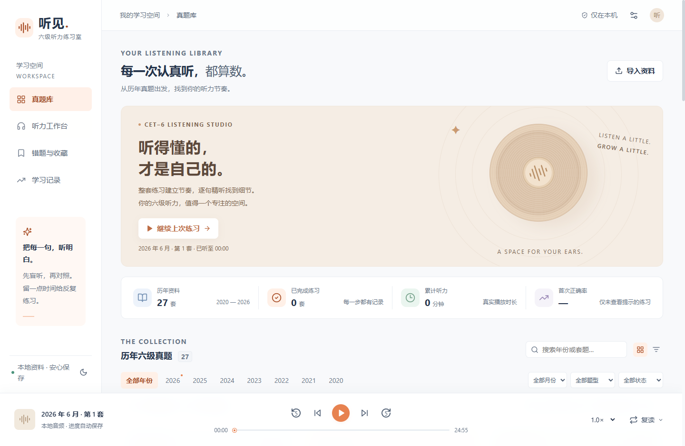

# 听见 · 六级听力工作室

一个在电脑本地运行的 CET-6 听力练习网页，围绕 **做题 → 批改 → 错题回听 → 逐句精听 → 再次练习** 组织学习。

React + TypeScript + Vite 前端，Node.js 24 本地服务，SQLite 保存学习记录。完成安装并导入本地资料后，日常练习无需联网或付费 AI 服务。



> 本仓库发布应用源码、工具和资料来源目录，**不附带真题音频、PDF、整站网页原件或个人学习记录**。截图来自导入资料后的本机版本；首次克隆启动显示空题库。
>
> 当前是可练习的**校对版**，尚未完成全库逐句人工听校，不能称为全部内容正式验收通过。当前为单人本机应用，尚无账号、微信登录或多人云同步。

## 已实现的功能

| 模块 | 能力 |
|---|---|
| 真题库 | 按年份、月份、题型、练习状态筛选，继续上次练习 |
| 获取资料 | 一键从公开来源获取音频、题目和原文；按年份选择、查看进度、停止后继续、跳过已有资料 |
| 听力工作台 | 篇章目录、逐句原文、选项作答和固定播放器 |
| 播放器 | 变速、前后5秒、上一句/下一句、单句1/3/5次或无限循环、句间停顿、A-B复读、整套循环 |
| 做题批改 | 首次隐藏原文和答案，自动保存草稿，统计答对、未答及分题型表现 |
| 精听复习 | 点击句子定位、当前句高亮、收藏、中文笔记、错因、依据句回听 |
| 学习记录 | 首次与复习作答分开，查看提示后标记辅助练习，统计实际播放时长 |
| 备份恢复 | 学习记录JSON、完整资料ZIP、每日首次启动自动备份并保留最近7份 |
| 界面 | 浅色/深色模式、可读字号、窗口缩放和键盘操作 |

全站共用一个播放器，切换面板时继续播放；再次打开网页需主动点击继续播放。输入笔记时不会触发播放快捷键。精确循环建议保持网页处于前台。

成绩以答对题数和正确率显示，不将简单比例换算标作官方六级听力报道分。

## 快速开始

### 环境

- Node.js **24.x**，包含 npm 和内置 SQLite；无需另装数据库。
- 推荐 Edge 或 Chrome。当前桌面验收环境为 Windows，其他系统尚未做同等浏览器验收。
- 首次安装依赖需要网络；本地播放、练习和记录保存不需要 Python、FFmpeg 或语音识别模型。

### 克隆、安装、启动

```bash
git clone https://github.com/ljl71/cet6-listening-studio.git
cd cet6-listening-studio
npm ci
npm run build
npm start
```

浏览器地址：<http://127.0.0.1:3260>。终端启动时按 `Ctrl+C` 停止服务。

Windows PowerShell 如提示不允许执行 `npm.ps1`，将命令中的 `npm` 换成 `npm.cmd`。构建完成后，也可双击 **启动听力.vbs**；禁用 VBS 的系统可双击 **启动听力.cmd**。双击启动会在后台运行，并复用已启动的本机服务；日志保存在 `runtime/server.log`。

### 一键获取资料（推荐）

首次启动后点击真题库的 **“一键获取真题资料”**，或 **“获取资料” → “获取资料”** 页签：

1. 选择全部目标年份，或先选择一个年份试用。
2. 点击 **“开始获取”**，等待音频、25道题和英文原文自动入库；无需下载后再手动导入。
3. 页面显示每套资料和音频片段的进度。可以关闭设置、刷新或换浏览器查看任务；本地服务需保持运行。
4. 中途可点击 **“停止获取”**；之后点击 **“继续上次获取”**。程序复用已下载片段，跳过本机已有且音频校验通过的资料，不覆盖已有校对和学习记录。

首次获取需要联网，建议预留约5 GB。**Windows x64 自动准备 FFmpeg/FFprobe**：从 Gyan 的公开构建下载约110 MB工具包，核对发布方提供的SHA-256，只提取两个必要程序，不需要Python或管理员安装。已有可用工具时直接复用；其他系统需自行安装FFmpeg/FFprobe，或设置`CET6_FFMPEG`和`CET6_FFPROBE`。

程序仅访问支持的公开来源，重新检查来源robots规则，遇到登录、403/429、加密音频或不受支持的重定向时停止；普通网络失败会有限重试，未完成项会显示具体原因。第三方来源随时可能变化，不能保证持续可用，也不会绕过限制。

获取期间可以正常保存练习记录和导出记录JSON；手动导入、修改时间轴和导出完整ZIP需先停止获取，避免同一资料同时被修改。

**获取成功表示文件已入库，不表示内容已核验。** 新下载的资料可整套/分篇播放、阅读原文和保存答题草稿；答案未经独立核验时暂不能自动批改，未校对的句子时间保持待处理，不会自动编造时间轴。它与本机经过多轮整理的校对版存在差别。

### 导入自己的资料（可选）

打开右上角“资料与设置” → “导入真题”，选择一套结构化试卷 JSON 和配套音频。支持 MP3、M4A、WAV、OGG、FLAC、MP4，当前单个音频导入上限100 MB。

JSON需要包含篇章、试题、选项、参考答案及原文等结构，**不是任意PDF或文本文件**；参考 [试卷模板](examples/paper.template.json)。模板全部是自制占位内容，不是真题。导入前应替换内容，填写实际音频时长和时间，不可把模板直接当成已校对材料。

也可以恢复自己合法持有的本项目资料备份，方法见下文。仅克隆源码不会自动下载或填充27套真题，需在页面主动开始获取。

## 资料目录和使用范围

本地整理目标为 **2020—2025 六个完整年份，补充2026年6月**，包括延期、加考的实际月份。27套来源链接、考试日期、音频校验值和整理状态见 [resources/catalog.json](resources/catalog.json)，原件处理说明见 [resources/README.md](resources/README.md)。

公开目录只包含来源及文件元数据，不包含完整试题选项、答案、原文或音频。来源链接和校验值用于追溯，不能视为考试机构认证或再分发授权。音频、译文、解析、PDF和网页原件的权利须分别确认；目前没有确认允许在此公开仓库重新打包分发的授权，故原件保留在本机。

仓库内采集工具可供维护者检查来源和整理自己有权使用的资料；它们不会随启动自动运行，也不保证外部站点长期可访问。不得绕过登录、付费、加密或访问限制。

### 内容验收状态

以下是 **2026-10-20 本地完整资料环境的结果**，不是源码仓库自带的内容量：

| 项目 | 本地整理结果 |
|---|---|
| 音频及题目 | 27个独立音频、675题、189篇 |
| 原文及时间 | 4,138句均有有效候选时间；重叠、越界和缺时为0 |
| 最近一轮处理 | 69项分歧逐项裁定：44句最小修改、25句保留；补齐26处缺时 |
| 当前限制 | 同音词、专名及弱读的编辑选择保留说明；全库逐句人工听校尚未完成 |
| 正式就绪 | 0/27套，正式内容检查仍返回失败 |

界面中的“待补齐”“待校对”“已核验”分别表示不同状态。机器识别结果、文件来源一致或合法时间范围，不等于实际首尾词已逐句听校。不要为了消除提示而批量勾选已核验。

原文和译文按实际来源粒度显示；只有段落译文时保留段落结构，不冒充逐句翻译。

## 数据保存与恢复

学习记录存放在项目目录的 `data/learning.sqlite`，音频、题库与原始资料也保存在 `data/`，不依赖浏览器缓存。切换浏览器不会删除这些记录；**删除项目中的data目录会丢失资料和记录**。

- **学习记录JSON**：在设置面板导出/恢复作答、播放进度、收藏和笔记。导入前自动备份，按稳定编号合并。
- **完整资料ZIP**：包含资料和学习记录，不含程序。大文件直接下载到磁盘，可查看浏览器下载进度。
- **自动备份**：每天首次启动创建记录备份，保留最近7份。请另存重要备份到其他磁盘。

恢复完整包时：先克隆本项目并完成构建，停止目标安装的服务，将备份内的 `data` 文件夹恢复到项目根目录，再启动并从设置面板导入包内 `learning-records.json`。不要覆盖正在运行的数据库，也不要把含个人学习记录的完整备份提交到公开仓库。

## 开发与检查

开发时使用两个终端：

```bash
# 终端1：本地API与音频服务
npm run server

# 终端2：Vite开发页面，/api和/media代理到本地服务
npm run dev
```

| 命令 | 用途 |
|---|---|
| `npm run build` | TypeScript检查与生产构建 |
| `npm test` | 基础回归测试；缺少未分发的真实资料或模型时，相关集成项明确跳过 |
| `npm run test:corpus` | 要求完整本地资料及模型夹具，缺失时失败，不把跳过当作完整验收 |
| `npm run audit` | 检查本机资料覆盖及质量 |
| `npm run check:release` | 正式内容门槛，未核验资料时返回非零退出码 |

本地完整环境已通过102项测试，覆盖获取任务互斥、取消与恢复、来源限制、续传和重复获取保护。此前已验证真实Edge/Chrome独立窗口的播放与作答、连续20次A-B循环、单句次数/停顿恢复、外网隔离后的本机练习及完整备份空目录恢复。源码仓库的自动构建只验证无需第三方资料的测试和构建，**不宣称已重现这些全量内容及真实浏览器验收**。

一键获取另在隔离目录中实际下载2026年6月两套资料，验证了Edge开始并停止、Chrome跨浏览器继续、复用已下载片段、自动入库，以及下载完成后阻断浏览器外站请求仍能播放。Windows工具准备也在无现成工具配置的目录中验证通过。

离线验收采用测试浏览器阻断外站请求，未关闭整台电脑的网络适配器。真实浏览器脚本是可选维护工具，目前包含特定Windows环境的路径，换电脑后需调整；不会在普通启动或CI中运行。

### 可选采集和校对工具

```bash
# 在确认有权访问与使用来源后，可仅整理文字
npm run collect -- --text-only

# 已准备FFmpeg/FFprobe时，按需整理一套音频
npm run collect -- --only=2025-12-1

# 查看答案交叉核对工具（需对应本地来源）
node scripts/verify-answers.mjs
```

页面的一键获取会自动准备Windows音频工具，命令行采集也复用相同流程。历史的`scripts/setup-tools.mjs`另提供识别工具准备入口，可能需要设置`CET6_PYTHON`指向自己的Python。采集器支持`CET6_FFMPEG`、`CET6_FFPROBE`指向现有工具。高级语音对齐还需要本地模型及额外Python依赖；这些缓存不随源码发布。

历史的逐项纠错/边界应用脚本绑定特定证据及SHA-256，不是任意资料的一键核验工具。缺少原证据时应停止，而不是修改校验常量或跳过审核。不要同时运行多个修改同一试卷的整理进程。

## 项目结构

```text
src/                 页面、播放器、播放进度保存
server/              本地API、SQLite记录、校验、媒体Range、备份恢复
scripts/             资料采集、来源核对、候选对齐与验收工具
tests/               基础测试及可选真实资料集成测试
examples/            自制的资料结构模板
resources/           27套资料的来源目录与校验元数据
docs/images/         文档界面截图
data/                本地资料和学习记录（不纳入版本管理）
runtime/             工具、模型、日志与临时校验文件（不纳入版本管理）
dist/                构建后的网页（首次运行前自行生成）
```

## 多人版本计划

后续可增加账号、微信登录、用户数据隔离、跨设备同步、管理员后台和在线部署。当前服务只监听 `127.0.0.1`，记录没有按用户隔离；不能直接开放公网当作多人网站。

提交问题时请说明系统、Node版本、浏览器版本和复现步骤。请勿在Issue或附件中提交个人学习数据库、账号密钥或未经许可分发的完整资料。源码许可证尚未选定，第三方依赖及资料遵循各自的许可条件。
